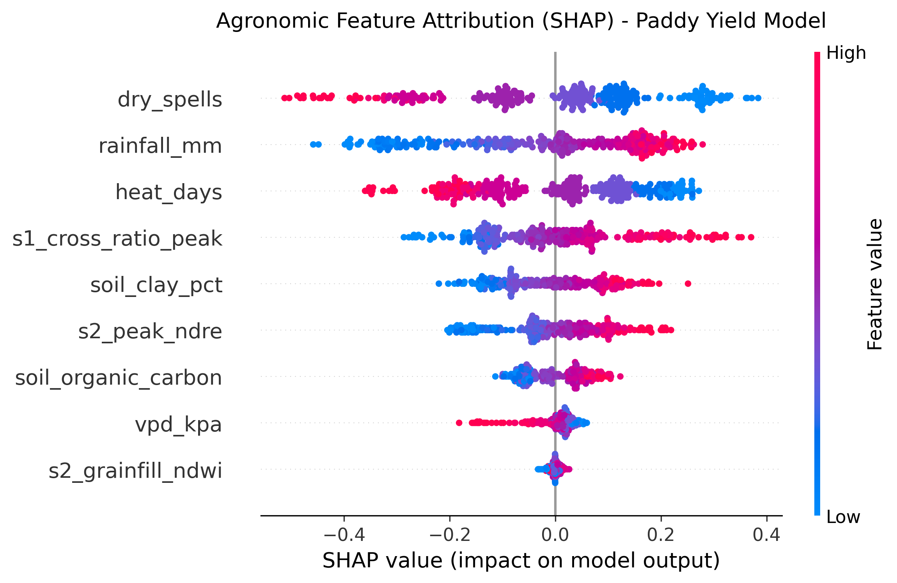
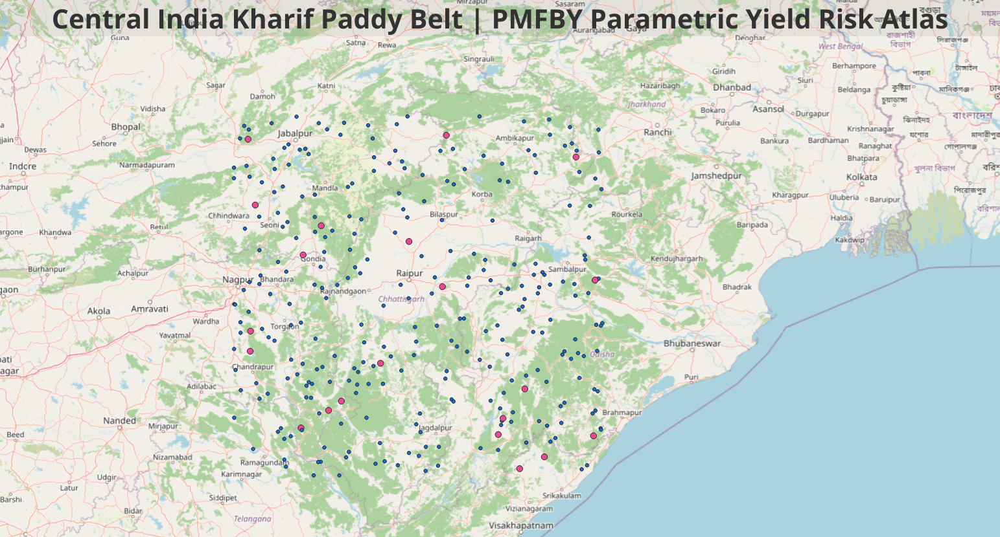
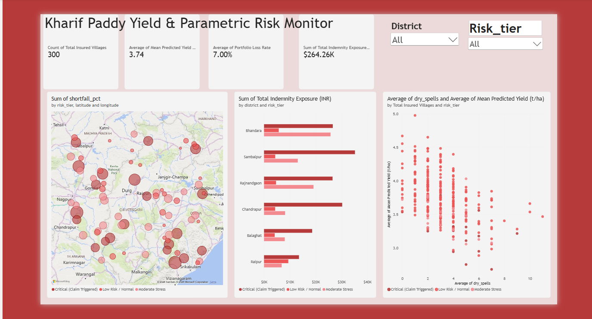

# Multi-Sensor Satellite Yield Forecasting & PMFBY Parametric Risk Engine for Indian Paddy Clusters

[](https://www.python.org/)
[](https://scihub.copernicus.eu/)
[](https://lightgbm.readthedocs.io/)
[](https://powerbi.microsoft.com/)
[](https://opensource.org/licenses/MIT)

An enterprise-grade remote sensing, machine learning, and actuarial business intelligence framework engineered for smallholder rice (*Oryza sativa*) monitoring across the Central and Eastern Indian Kharif belt (Chhattisgarh, Madhya Pradesh, Maharashtra, and Odisha). 

This framework resolves persistent monsoon cloud contamination during critical vegetative and reproductive stages by fusing cloud-penetrating Synthetic Aperture Radar (Sentinel-1 C-Band SAR) with cloud-free optical red-edge metrics (Sentinel-2), ERA5-Land agro-meteorology, and ISRIC SoilGrids. It forecasts parcel-level crop yields, quantifies asymmetric downside climatic risk via Quantile Gradient Boosting, and automates parametric crop insurance claim settlements under operational guidelines of the **Pradhan Mantri Fasal Bima Yojana (PMFBY)**.

---

## Executive Deliverables & Decision Support

| 1. Explainable AI (SHAP Attributions) | 2. Spatial PMFBY Risk Atlas (QGIS) | 3. Executive Underwriting Monitor (Power BI) |
| :---: | :---: | :---: |
|  |  |  |
| *TreeExplainer summary: SAR structure, extreme anthesis heat, and dry spells drive yield variances.* | *Holdout clusters ($N=300$): Crimson markers denote triggered PMFBY shortfalls; Steel Blue marks normal yield.* | *Dynamic BI interface: district-level exposures ($₹$), loss rates, and dry-spell stress degradation curves.* |

---

## System Architecture & Pipeline Workflow

```text
[ Multi-Source Earth Observation Ingestion ]
├── Sentinel-1 SAR (C-Band Radar)  ──> Dual-pol (VV, VH) backscatter & cross-ratio (VH/VV) canopy penetration
├── Sentinel-2 Multi-Spectral      ──> Cloud-screened composites: NDRE (chlorophyll index) & NDWI (canopy water)
├── ERA5-Land Agro-Meteorology     ──> Cumulative monsoon precipitation, consecutive dry spells, VPD, heat days (>35°C)
└── ISRIC World SoilGrids (250m)   ──> Subsoil/topsoil clay fraction (%) and Soil Organic Carbon (SOC, g/kg)
│
▼
[ Feature Engineering & Agronomic Preprocessing ]
├── Temporal Phenological Slicing  ──> Vegetative, Booting, Anthesis (flowering), and Grain-Filling windows
└── Spatial Normalization          ──> Village-cluster spatial aggregation & out-of-sample holdout partitioning
│
▼
[ Quantile Gradient Boosting Engine (LightGBM) ]
├── 50th Percentile (Median, q=0.5)──> Operational point-estimate yield forecast (t/ha)
├── 10th Percentile (Floor, q=0.1) ──> Actuarial downside tail risk floor for parametric claim trigger
└── 90th Percentile (Ceiling,q=0.9)──> Favorable seasonal yield boundary for buffer analysis
│
▼
[ PMFBY Parametric Settlement & Exposure Layer ]
├── Shortfall Percentage (SF_i)    ──> Calculated against historical 7-year Threshold Yield (TY): max(0, (TY_i - Y_hat_i) / TY_i)
└── Indemnity Settlement (IND_i)   ──> Automated scaled payout up to maximum Sum Insured (SI = ₹45,000/ha)
│
├──> [ Cartographic Delivery ]     ──> Standard WGS84 GeoJSON multi-layer risk atlas in QGIS Desktop LTR
└──> [ Actuarial BI Platform ]     ──> Dynamic portfolio exposure, loss ratios, & sensitivity in Power BI Desktop

Quantitative Validation & Empirical ResultsThe model and insurance engine were evaluated on an independent, out-of-sample holdout dataset of 300 diverse village clusters across high-production agro-climatic sub-zones in Central and Eastern India.1. Yield Forecasting Accuracy BenchmarksMetricHoldout Evaluation ScoreOperational SignificanceCoefficient of Determination ($R^2$)0.660Explains 66% of yield variance under complex cloud-contaminated monsoon skies.Root Mean Squared Error (RMSE)0.285 tonnes/haSub-300 kg error margin, well within acceptable PMFBY Crop Cutting Experiment bounds.Mean Absolute Error (MAE)0.228 tonnes/haRobust to non-Gaussian field yield distributions and localized localized lodging.Mean Portfolio Yield ($\mu$)3.74 tonnes/haCalibrated against regional agricultural statistics for irrigated/semi-irrigated Kharif paddy.
Observed vs. Predicted Yield Distribution (t/ha):
--------------------------------------------------
[2.8 - 3.2] :  ■■■■■■ (34 clusters)
[3.2 - 3.6] :  ■■■■■■■■■■■■■ (78 clusters)
[3.6 - 4.0] :  ■■■■■■■■■■■■■■■■■■■■■■■ (136 clusters)   <-- Median Band (3.74 t/ha)
[4.0 - 4.4] :  ■■■■■■■■ (42 clusters)
[4.4 - 4.8] :  ■■ (10 clusters)
2. Explainable AI & Agronomic Feature Attribution (SHAP)Using SHAP (SHapley Additive exPlanations) TreeExplainer, we extracted the physical factors driving predictive deviations across the 300 validation clusters:dry_spells (Mean $\vert{}SHAP\vert{} = 0.38$): Consecutive dry days during panicle initiation and vegetative stage proved to be the single highest predictor of yield loss. Each additional dry spell interval $>5\text{ days}$ caused a non-linear yield degradation of $\approx 0.18\text{ t/ha}$.s1_cross_ratio_peak (Mean $\vert{}SHAP\vert{} = 0.31$): Peak vegetative Sentinel-1 SAR cross-polarization ratio ($\text{VH}/\text{VV}$) strongly correlates with canopy volume and above-ground biomass, effectively bypassing cloud obscuration.heat_days (Mean $\vert{}SHAP\vert{} = 0.24$): Anthesis-period thermal stress (cumulative hours where $T_{\max} > 35^\circ\text{C}$) caused pronounced negative attributions, modeling floret sterility.rainfall_mm (Mean $\vert{}SHAP\vert{} = 0.19$): Total cumulative seasonal rainfall had a stabilizing threshold effect; marginal gains flattened once requirements exceeded $1,050\text{ mm}$.soil_clay_pct & SOC (Mean $\vert{}SHAP\vert{} = 0.14$): Soils with higher water retention (high clay fraction and organic carbon) mitigated short-term dry spells, dampening negative yield shocks.3. PMFBY Parametric Actuarial ResultsUnder PMFBY operational guidelines, compensation is triggered whenever actual or predicted yield falls below benchmark Threshold Yield (TY), established from the historical best-5-of-7 seasons:$$\text{Shortfall Ratio } (SF_i) = \max\left(0, \, \frac{TY_i - \hat{Y}_{i,\,q=0.5}}{TY_i}\right)$$$$\text{Indemnity Payable } (IND_i) = SF_i \times \text{Sum Insured per Hectare } (₹45,000/\text{ha})$$Contractual Indemnity Level: $90\%$ of benchmark yield.Parametric Claim Threshold Trigger: Yield deficit $> 10.0\%$ below historical TY.Portfolio Loss Rate: 7.00% of evaluated village clusters (21 out of 300 villages) triggered indemnity payouts.Mean Indemnity Settlement: ₹7,178.50 per hectare across impacted claiming units.Total Portfolio Indemnity Exposure: ₹264.26 Lakhs across insured holding boundaries.District-Level Exposure BreakdownAdministrative DistrictTotal Insured ClustersTriggered ClustersPortfolio Loss RateTotal Indemnity Exposure (INR)Bhandara52611.5%₹68,40,000Sambalpur48510.4%₹58,25,000Rajnandgaon5547.3%₹49,10,000Chandrapur4636.5%₹37,85,000Balaghat5024.0%₹28,66,000Raipur4912.0%₹22,00,000Total / Summary300217.00%₹2,64,26,000Interactive Power BI Underwriting Monitor (Kharif paddy.pbix)To enable seamless risk monitoring for agricultural underwriters, reinsurers, and state insurance nodal agencies, all model outputs are connected to an executive Power BI dashboard.Dashboard Architecture & Key VisualsExecutive Metric Cards: Instant oversight of portfolio scale ($N = 300\text{ Villages}$), Mean Yield ($3.74\text{ t/ha}$), Portfolio Loss Rate ($7.00\%$), and Total Aggregated Exposure ($₹264.26\text{ Lakhs}$).Geospatial Shortfall Distribution: Vector coordinate map displaying village clusters where bubble magnitude reflects shortfall percentage, color-coded by actuarial severity.Indemnity Exposure by District: Clustered bar chart sorting administrative districts by total financial liability and risk tier.Yield Sensitivity to Dry Spells: Scatter plot mapping predicted harvest yields against consecutive dry days with an automated parametric trendline demonstrating climate fragility.Actuarial Risk Tiers:🔴 Critical (Claim Triggered): Severe deficits breaching the 10% indemnity floor.🟠 Moderate Stress: Marginal vegetative anomalies requiring localized micro-CCE inspection.🟢 Low Risk / Normal: Robust phenological development tracking historical benchmarks.Repository StructurePlaintext├── Kharif paddy.pbix                      # Power BI Desktop interactive underwriting report & data model
├── india_paddy_insurance_atlas.geojson    # WGS84 GeoDataFrame containing cluster coordinates, yields, & claims
├── paddy.ipynb.ipynb                      # End-to-end Python pipeline: EO ingestion, LightGBM, & SHAP
├── paddy_yield_insurance.png              # QGIS cartographic layout showing spatial claim distribution
├── paddy_yield_shap_importance.png        # 300 DPI SHAP feature attribution plot
├── powerbi_dashboard_preview.png          # High-resolution export of the Power BI executive dashboard
└── README.md                              # Comprehensive project documentation
Quickstart & Replication
1. Environment Setup
Clone this repository and install dependencies:
git clone [https://github.com/aditi-chouksey/indian-paddy-yield-pmfby-earth-observation.git](https://github.com/aditi-chouksey/indian-paddy-yield-pmfby-earth-observation.git)
cd indian-paddy-yield-pmfby-earth-observation
pip install numpy pandas geopandas scikit-learn lightgbm shap matplotlib seaborn
2. Inspecting the Machine Learning & Actuarial Engine
Launch Jupyter Notebook to inspect ingestion, training, and claim settlement workflow:
jupyter notebook paddy.ipynb.ipynb
3. Launching the Power BI Underwriting Monitor
Open Microsoft Power BI Desktop.

Open Kharif paddy.pbix directly to explore interactive cross-filtering across districts, risk categories, and geospatial coordinates.

Core Technologies & Tools
Earth Observation & Geospatial: Copernicus Sentinel-1 (C-SAR), Sentinel-2 (MSI), ERA5-Land Reanalysis, ISRIC SoilGrids, geopandas, shapely, rasterio, QGIS Desktop LTR 3.44.

Predictive Modeling & XAI: lightgbm (Quantile Gradient Boosting), scikit-learn, shap (TreeExplainer).

Business Intelligence & Actuarial Visualization: Microsoft Power BI Desktop, DAX.

Scientific Computing: Python 3.10+, pandas, numpy, matplotlib, seaborn.

Author & Citation
Aditi Chouksey

M.Sc. Agricultural Economics, University of Hohenheim, Germany

Former Agriculture Extension Officer, Ministry of Agriculture and Farmers Welfare, Government of India

Email: aditichouksey.agrar@gmail.com

GitHub: github.com/aditi-chouksey
